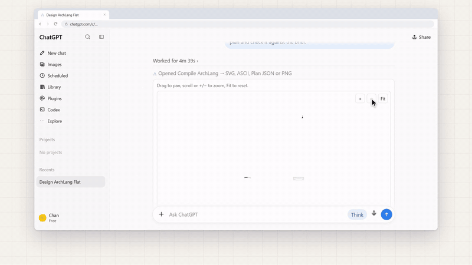
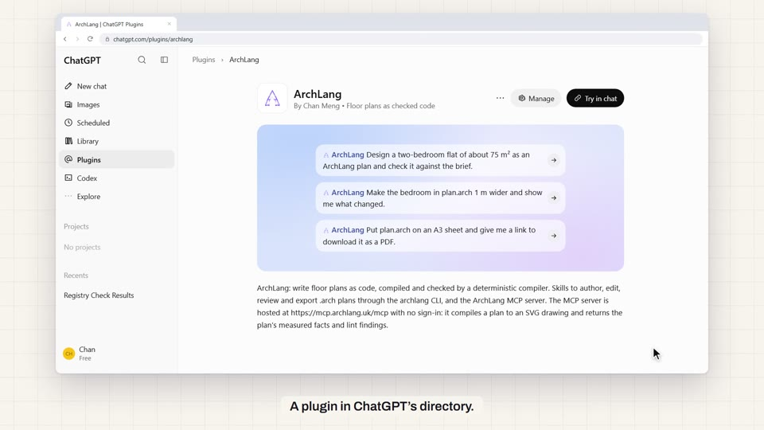
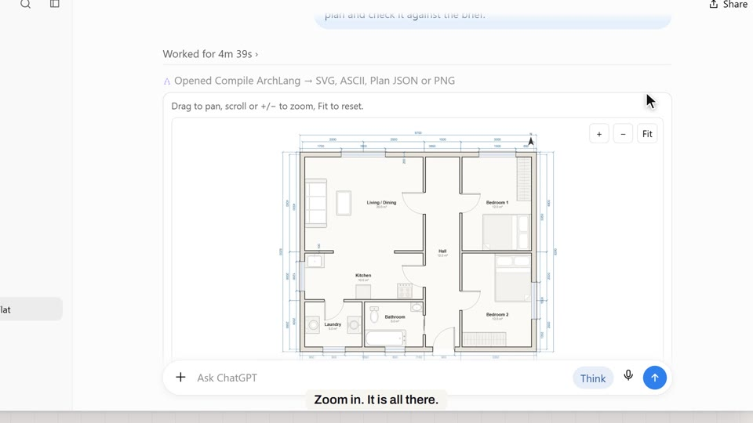
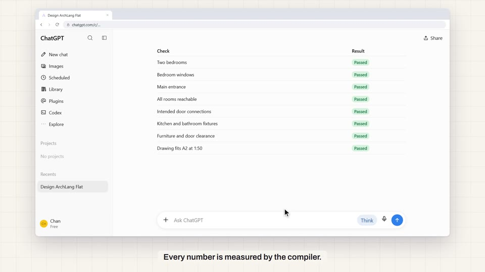
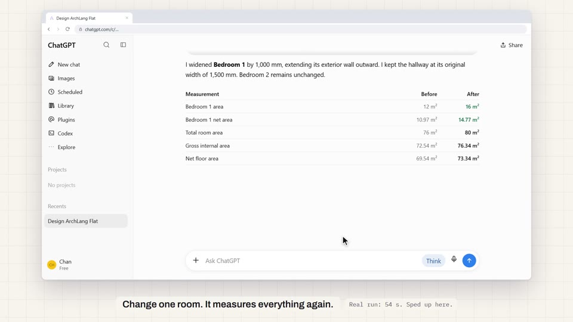
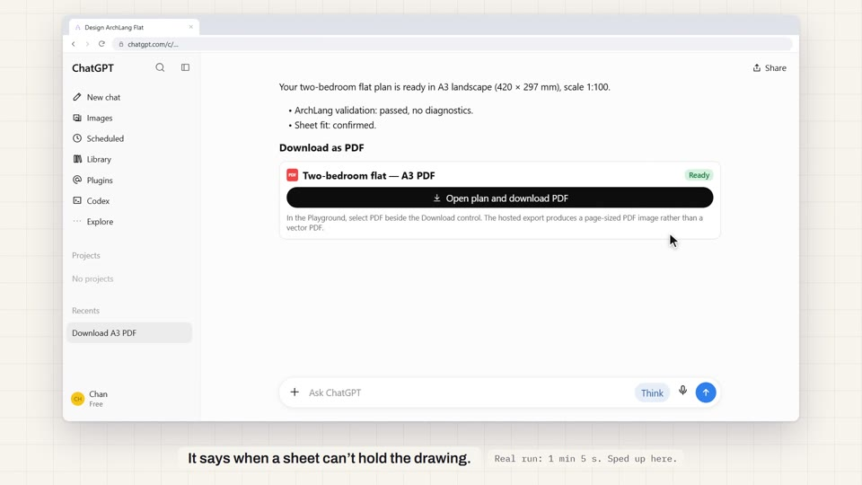
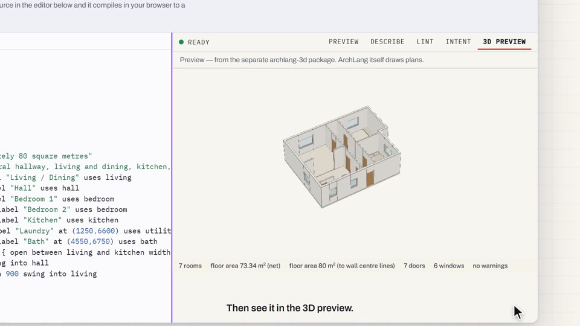

<div align="center">

# ArchLang in ChatGPT · the film

**An 82-second film of [ArchLang](https://github.com/ChanMeng666/archlang) at work inside ChatGPT, written as code.**

A rebuilt browser and cursor go from the plugin page to a checked floor plan, an edit, an A3 PDF and a 3D preview.

<!-- FILM: archlang-in-chatgpt-film -->

[](https://github.com/ChanMeng666/film-archlang-in-chatgpt/releases/latest)


https://github.com/user-attachments/assets/4b7a867e-9651-40a4-b352-eb4969fd3424


**[Watch or download the film](https://github.com/ChanMeng666/film-archlang-in-chatgpt/releases/latest)** · **[Try ArchLang in ChatGPT](https://chatgpt.com/plugins/plugin_asdk_app_6acf8381cca08191bfb3eb7305fb6970)** · **[Credits](CREDITS.md)**

</div>

## What the film shows

| Time | Scene | What happens on screen |
|---|---|---|
| 0:00 | Hook | "Ask ChatGPT for a floor plan. Get one a compiler checked." A plan draws itself. |
| 0:07 | Plugin page | ArchLang's listing in ChatGPT. The cursor picks a starter prompt. |
| 0:14 | The work | ChatGPT writes the plan, compiles it, reads the checks and fixes what they find. |
| 0:24 | The drawing | The compiler's own SVG draws in the chat, layer by layer, then zooms in on the card's `+` button. |
| 0:33 | The checks | Measured areas count up. Eight checks pass on the beat. |
| 0:41 | The edit | "Make the bedroom 1 m wider." The diff, the new plan and the before-and-after figures. |
| 0:53 | The sheet | A3 at 1:50 raises `W_SCALE_OVERFLOW`. At 1:100 it fits, and ChatGPT links the PDF. |
| 1:02 | Playground | The plan opens, the PDF downloads, and the real 3D preview plays. |
| 1:12 | End card | Search ArchLang in ChatGPT's plugins. |

| | |
|---|---|
|  |  |
|  |  |
|  |  |

## What is real

The pages are recreated, not recorded. What they show is real.

- **Drawings and numbers** come from the ArchLang 1.50.0 compiler. `npm run bake` regenerates them.
- **Quoted messages** are checked against text read from the live pages, kept in [`data/sources/`](data/sources/).
- **Compressed time is captioned.** The real runs took 4 min 39 s, 54 s and 1 min 5 s.
- **The 3D preview** is the only captured picture: the Playground's own replay of this plan.
- **Messages are condensed.** The sheet scene joins two sessions, and the end card says so.

ChatGPT's own note applies to the plan: a concept, not a construction-ready design.

## How it is made

Every frame is a pure function of time in [Remotion](https://www.remotion.dev/). The picture sets the timeline, and the score reads its cues from it, so a click and its sound share one source. The score is original, in D major at 100 BPM, where a beat is exactly 18 frames.

```sh
npm install
npm run bake        # plans through the real compiler
npm run plate       # the 3D preview, frame by frame (needs Chrome and network)
sh audio/build.sh   # cues, the GS layer, then the sampled score
npm run gates       # add -- --master after a render
npm run render
```

`audio/build.sh` expects two sibling folders that are not part of this repository: `AI_MUSIC_CREATOR` and `film-archlang-one-take/samples`. `public/soundtrack.wav` ships with the [release](https://github.com/ChanMeng666/film-archlang-in-chatgpt/releases/latest), so you can render the picture without them.

`src/time.ts` holds all frame arithmetic, `src/timeline.ts` every cue, `src/copy.ts` every word, and `scripts/gates.ts` the checks.

## Licence

Code is under the [MIT licence](LICENSE). The film and its score are under [CC BY 4.0](LICENSE-MEDIA.md). Third-party material keeps its own terms: see [CREDITS.md](CREDITS.md).

ChatGPT is a trademark of OpenAI. ArchLang is an independent project, and OpenAI did not make or endorse this film.
